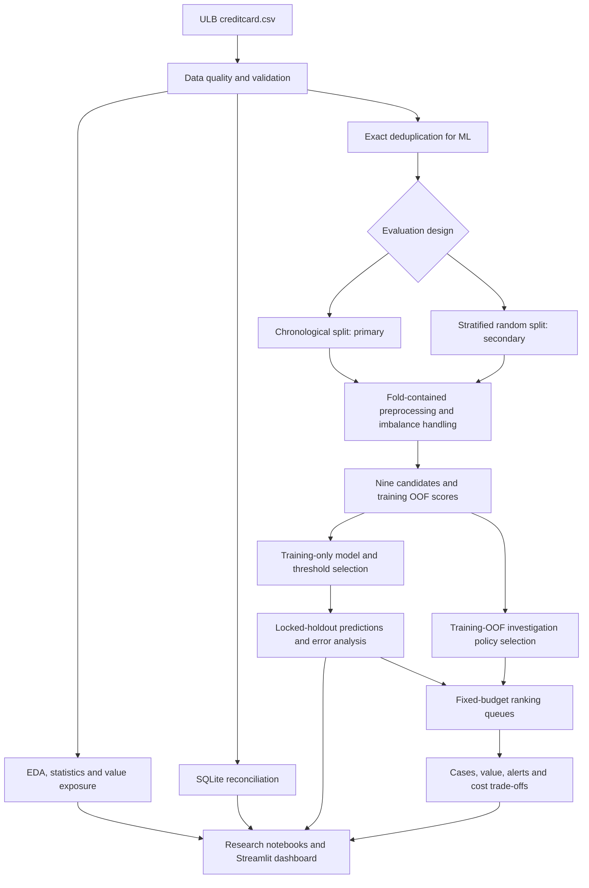

<div align="center">

# Credit Card Fraud Analytics & Investigation Optimization

### Beyond predicting fraud: deciding what to investigate when review capacity is limited

**Python · SQL · Statistical Analysis · Machine Learning · XGBoost · Streamlit · Jupyter**

[](https://www.python.org/)
[](https://pandas.pydata.org/)
[](https://scikit-learn.org/)
[](https://xgboost.readthedocs.io/)
[](https://fraud-investigation-analytics.streamlit.app/)
[](https://www.sqlite.org/)
[](LICENSE)

**Historical fraud analytics · Auditable model evaluation · Capacity-constrained investigation decisions**

### [Explore the Live Dashboard](https://fraud-investigation-analytics.streamlit.app/) · [View Source Code](https://github.com/anandhusuresh04/Credit-Card-Fraud-Analytics)

[Key Findings](#key-findings) · [Investigation Results](#investigation-optimization-from-scores-to-decisions) · [Research Notebooks](#research-notebooks) · [Methodology](#machine-learning-and-validation-methodology) · [Run Locally](#getting-started)

</div>

---

## Project overview

A fraud model can rank suspicious transactions, but an investigation team still faces a practical constraint: **it cannot review every transaction**. This project studies both the predictive problem and the downstream decision problem—**which transactions should be reviewed first when capacity is fixed?**

Using the public ULB/Kaggle credit card dataset, the workflow combines data-quality auditing, SQLite reconciliation, exploratory and statistical analysis, business exposure segmentation, supervised model selection, locked-holdout evaluation, and retrospective investigation-queue simulation.

Two simple queue policies are compared on the **same saved model scores**:

- **Fraud-score ranking:** review the highest-scored transactions first.
- **Value-aware ranking:** review transactions ranked by `fraud_score × Amount`.

The objective is not to proclaim a universal winner. It is to understand how **fraud cases detected, recorded fraudulent-value coverage, false alerts, and hypothetical review economics** change with investigation capacity.

> [!IMPORTANT]
> This is an **offline research and portfolio application**, not a live banking system. Its dashboard displays historical analytical artifacts; it does not score live payments, block transactions, or establish actual fraud losses or savings.

## Key findings

| Finding | Verified result | Interpretation |
|:--|--:|:--|
| Original transactions | **284,807** | Population for descriptive analysis and SQL reconciliation |
| Fraud records | **492 (0.1727%)** | Extreme class imbalance |
| Exact duplicate rows | **1,081** | Removed before model splitting |
| Recorded fraudulent transaction amount | **60,127.97** | Dataset amount units; **not confirmed financial loss** |
| Lowest transaction-amount decile | **36.79% of fraud cases; 0.23% of fraudulent value** | Case frequency and recorded value diverge |
| Highest transaction-amount decile | **17.28% of fraud cases; 78.11% of fraudulent value** | High-value exposure is concentrated |
| Zero-amount vs. nonzero-amount fraud relative risk | **~9.0×** | Exploratory association, not a causal rule |
| Chronological holdout average precision | **0.7831** | Model discrimination on the primary locked holdout |
| Chronological holdout precision / recall | **82.98% / 72.90%** | At the training-selected classification threshold |
| Chronological classifier fraudulent-value recall | **71.22%** | Recorded fraud amount flagged at that threshold |

### Flagship finding: the preferred queue changes with capacity

The primary chronological holdout contains **85,118 transactions**, including **107 fraud cases**. Both ranking rules were applied at identical, predefined review budgets.

| Reviews per 10,000 transactions | Review slots | Fraud-score ranking: value coverage | Score × amount ranking: value coverage | Value-aware difference |
|---:|---:|---:|---:|---:|
| **5** | **42** | 19.28% | **62.98%** | **+43.70 percentage points** |
| 10 | 85 | 70.94% | **71.43%** | +0.49 percentage points |
| **20** | **170** | **87.75%** | 83.84% | −3.91 percentage points |
| 50 | 425 | **87.96%** | 87.13% | −0.83 percentage points |

At **5 reviews per 10,000 transactions**, the value-aware ranking covered substantially more of the **historically recorded fraudulent transaction value**. At **20 reviews per 10,000**, score-only ranking detected **84 fraud cases versus 28** and raised **86 legitimate alerts versus 142** for value-aware ranking.

**Takeaway:** A ranking policy that looks attractive at one capacity can be inferior at another. These are retrospective **holdout comparisons**, not evidence of recovered money. The training-selected operational policy is chosen separately using **training out-of-fold (OOF) evidence**, never by selecting whichever policy looks best on the holdout.

**[Explore the investigation results in the live dashboard](https://fraud-investigation-analytics.streamlit.app/)**

---

## Explore the project

| Component | What it demonstrates |
|:--|:--|
| **[Live Streamlit dashboard](https://fraud-investigation-analytics.streamlit.app/)** | Five interactive workspaces for patterns, statistics, model evidence, and investigation decisions |
| [Notebook 01 — Data Understanding & EDA](notebooks/01_data_understanding_eda.ipynb) | Dataset structure, quality, prevalence, transaction amounts, elapsed time, and anonymized feature patterns |
| [Notebook 02 — Statistical & Business Insights](notebooks/02_statistical_business_insights.ipynb) | Exploratory tests, effect sizes, uncertainty, segment exposure, and illustrative business scenarios |
| [Notebook 03 — ML Experiments & Evaluation](notebooks/03_ml_experiments_evaluation.ipynb) | Nine model configurations per full run, training-only selection, saved holdout predictions, and error analysis |
| [Notebook 04 — Investigation Optimization](notebooks/04_investigation_optimization.ipynb) | Eight reconstructed chronological queues, capacity trade-offs, policy provenance, and sensitivity analysis |
| [SQL analysis](sql/) | Independent SQLite reconciliations and analytical queries |
| [Automated tests](tests/) | Unit and consistency checks |

**Suggested order:** Notebooks **01 → 02 → 03 → 04**. For the central decision-making insight, begin with Notebook 04; for validation design, see Notebook 03.

## End-to-end architecture



### Analysis populations: keep the denominators separate

| Population | Transactions | Fraud labels | Purpose |
|:--|--:|--:|:--|
| Original dataset | 284,807 | 492 | EDA, statistical/business analysis, SQL reconciliation |
| Exact-deduplicated dataset | 283,726 | 473 | ML development and evaluation |
| Chronological training partition | 198,607 | — | Cross-validation, OOF selection, fitting |
| Chronological locked holdout | 85,118 | 107 | Primary model and queue evaluation |
| Stratified random locked holdout | 85,118 | 142 | Secondary sensitivity evaluation |

One boundary row was excluded from the chronological split to maintain strict timestamp separation. The random and chronological holdouts have **different composition**, and their selected models also differ; comparing their scores does not isolate a causal effect of the split strategy.

---

## Machine learning and validation methodology

### Candidate search

Each full experiment compares **nine configurations** across three model families and three imbalance-handling strategies.

| Model family | Baseline | SMOTE | Class weighting |
|:--|:---:|:---:|:---:|
| Logistic Regression | ✓ | ✓ | ✓ |
| Random Forest | ✓ | ✓ | ✓ |
| XGBoost | ✓ | ✓ | ✓ |

The primary chronological experiment uses **three-fold expanding-window `TimeSeriesSplit`**. Preprocessing and any resampling are fitted within the relevant training folds to limit leakage.

Model and threshold selection occur **before** evaluation on the locked holdout:

1. **Model selection:** highest pooled training-OOF **average precision (AP)**.
2. **Classification threshold:** training-OOF **F1** maximization for the selected model.
3. **Holdout evaluation:** apply the selected model and threshold once to the reserved test data.

A classification threshold is **not** the same thing as a fixed-capacity investigation queue: the former produces binary predictions, while the latter orders transactions and selects a specified number for review.

### Primary chronological holdout

| Metric | Result |
|:--|--:|
| Selected model | **XGBoost + SMOTE** |
| Training-selected threshold | **0.715498** |
| Holdout transactions / fraud cases | **85,118 / 107** |
| Average precision (AP; reported as PR-AUC) | **0.7831** |
| Precision | **82.98%** |
| Recall | **72.90%** |
| F1 | **0.7761** |
| Fraudulent-value recall | **71.22%** |
| True positives / false positives | **78 / 16** |
| False negatives / true negatives | **29 / 84,995** |
| Recorded fraudulent amount flagged / missed | **10,372.83 / 4,192.16** |

**Secondary random holdout:** XGBoost + class weighting; **AP 0.8112**, **precision 93.86%**, **recall 75.35%**, **F1 0.8359**. This is supporting context, not a controlled claim that random splitting or one imbalance strategy is inherently superior.

Notebook 03 audits the **saved transaction-level holdout predictions** against the stored training-selected threshold and reproduces confusion-matrix metrics. It does not claim to perform fresh inference or retrain the model when opened.

## Investigation optimization: from scores to decisions

The investigation study simulates **fixed-size retrospective review batches**, rather than real-time payment blocking.

```text
Fraud-score policy: rank_i = fraud_score_i
Value-aware policy: rank_i = fraud_score_i × Amount_i

Review slots = floor(N_holdout × reviews_per_10,000 / 10,000)
```

The four review budgets are **5, 10, 20, and 50 reviews per 10,000 transactions**. Ties are broken deterministically using the original row identifier.

The independent checks cover all **eight primary chronological queues** (two ranking policies × four budgets), fraud cases captured, recorded fraudulent-value coverage, legitimate alerts, legitimate transaction amount flagged, and marginal returns from additional review slots. Investigation-policy selection is checked against **training OOF evidence**, separately from holdout comparisons. Additional financial scenarios vary assumed review costs, intervention effectiveness, and legitimate-alert friction.

> [!CAUTION]
> `fraud_score × Amount` is a **ranking heuristic**, not a calibrated estimate of expected financial loss. A flagged historical fraud transaction is not proof that an intervention would have prevented a loss. All financial scenario outputs are **hypothetical**, not realized savings.

---

## Live interactive Streamlit dashboard

### **[Launch Fraud Risk Lab](https://fraud-investigation-analytics.streamlit.app/)**

The dashboard is deployed publicly on **Streamlit Community Cloud** and reads saved analytical outputs. **No raw transaction upload, live transaction scoring, or model retraining is required to explore the deployed app.**

| Workspace | Explore |
|:--|:--|
| **Overview** | Fraud prevalence, transaction-value concentration, and elapsed-time patterns |
| **Risk & Statistics** | Segment associations, statistical evidence, effect sizes, and uncertainty |
| **Model Lab** | Training selection, holdout performance, and model errors |
| **Investigation Studio** | Review-budget frontiers, case/value trade-offs, false alerts, and scenario assumptions |
| **Data & Methodology** | Dataset populations, experiment provenance, and analytical limitations |

The **Overview page and live deployment have been visually confirmed**. Other pages and interactive controls should be checked separately after each substantive dashboard update; a successful deployment alone does not verify every interaction.

**Run locally** from the repository root:

```powershell
.\.venv\Scripts\python.exe -m streamlit run dashboard/app.py
```

Then open `http://localhost:8501`. Local use depends on the matching saved artifacts in `reports/`.

---

## Tech stack

| Layer | Tools |
|:--|:--|
| Data processing | Python, pandas, NumPy |
| Statistical analysis | SciPy, effect sizes, Holm correction, Wilson intervals, bootstrap uncertainty |
| Visualization | Matplotlib, Plotly |
| Machine learning | scikit-learn, imbalanced-learn (SMOTE), XGBoost, joblib |
| SQL | SQLite, analytical SQL and reconciliation checks |
| Interactive application | Streamlit Community Cloud |
| Research and quality assurance | Jupyter, VS Code, `unittest`, Git/GitHub |

## Repository structure

```text
Credit-Card-Fraud-Analytics/
├── README.md
├── LICENSE
├── .gitignore
├── pyproject.toml
├── requirements.txt
├── requirements_dashboard.txt
├── configs/
│   └── model_config.yaml
├── .streamlit/
│   └── config.toml
├── data/
│   └── raw/                    # creditcard.csv downloaded separately; not committed
├── src/                        # data, statistics, ML, evaluation, optimization, SQL
├── sql/                        # schema and analytical queries
├── dashboard/
│   ├── app.py
│   └── data_access.py
├── notebooks/
│   ├── 01_data_understanding_eda.ipynb
│   ├── 02_statistical_business_insights.ipynb
│   ├── 03_ml_experiments_evaluation.ipynb
│   └── 04_investigation_optimization.ipynb
├── reports/
│   ├── tables/                 # selected published analytical outputs
│   └── figures/                # saved plots and diagnostics
└── tests/
```

The tree summarizes the main tracked components, not every generated local directory. Raw data, model binaries, and large training-only artifacts are intentionally excluded from Git. Some notebooks or regeneration commands may require artifacts that are not part of the published snapshot.

---

## Getting started

### Option A: Explore without installing anything

Open the **[live Streamlit dashboard](https://fraud-investigation-analytics.streamlit.app/)** or read the four notebooks on GitHub. This is the fastest path for reviewers and recruiters.

### Option B: Run locally (Windows / PowerShell)

**Prerequisites:** Git, Python **3.10** (the development environment), and the public ULB/Kaggle dataset. The deployed cloud app was configured with Python **3.11**. A fresh-clone, end-to-end regeneration on a separate machine has not been fully verified.

**1. Clone and install**

```powershell
git clone https://github.com/anandhusuresh04/Credit-Card-Fraud-Analytics.git
cd Credit-Card-Fraud-Analytics

py -3.10 -m venv .venv
.\.venv\Scripts\python.exe -m pip install --upgrade pip
.\.venv\Scripts\python.exe -m pip install -r requirements.txt
```

**2. Obtain the source dataset**

Download [Credit Card Fraud Detection (ULB/Kaggle)](https://www.kaggle.com/datasets/mlg-ulb/creditcardfraud) and place the CSV at:

```text
data/raw/creditcard.csv
```

The dataset's `Time` field represents elapsed seconds, and `Amount` does **not** provide a verified currency or confirmed loss figure.

**3. Regenerate descriptive, statistical, business, and SQL artifacts**

```powershell
.\.venv\Scripts\python.exe -m src.data_cleaner
.\.venv\Scripts\python.exe -m src.data_cleaner --duplicates drop --output data/processed/deduped.csv --report-dir reports/tables/data_quality/deduped
.\.venv\Scripts\python.exe -m src.analysis
.\.venv\Scripts\python.exe -m src.visualization --format png
.\.venv\Scripts\python.exe -m src.statistical_analysis
.\.venv\Scripts\python.exe -m src.business_analysis
.\.venv\Scripts\python.exe -m src.sql_pipeline
```

**4. Optional: regenerate full ML experiments (compute-intensive)**

```powershell
.\.venv\Scripts\python.exe -m src.ml_models --split chronological
.\.venv\Scripts\python.exe -m src.ml_models --split random
```

Use the **actual newly generated run directory** for downstream evaluation and optimization:

```powershell
# Example from the documented chronological experiment.
# Replace this path with your newly generated run folder if it differs.
$run = "reports/tables/ml/chronological_dedup_withTime_463fcded"

.\.venv\Scripts\python.exe -m src.model_evaluation --run-dir $run --format png svg
.\.venv\Scripts\python.exe -m src.investigation_optimization --run-dir $run
```

Repeat downstream commands for the random run if desired. **Never mix prediction files, metrics, and investigation outputs across run IDs.** Large training OOF and threshold-curve files are excluded from Git and must be regenerated for workflows that require them.

**5. Open the notebooks or dashboard**

```powershell
.\.venv\Scripts\python.exe -m pip install ipykernel
.\.venv\Scripts\python.exe -m ipykernel install --user --name fraud-analytics --display-name "Python (Fraud Analytics)"
.\.venv\Scripts\python.exe -m streamlit run dashboard/app.py
```

Use the project's `.venv` kernel when running notebooks in VS Code/Jupyter. The four final notebooks were executed locally during development.

**6. Run automated tests**

```powershell
.\.venv\Scripts\python.exe -m unittest discover -s tests -v
```

**Reproducibility scope:** Saved reports, tests, and the notebooks were checked during development; the public dashboard is deployed. A completely fresh installation and full regeneration on an independent machine remains **unverified**. Published outputs are not a substitute for retraining artifacts excluded from version control.

---

## Validation record

| Component | Verified development evidence |
|:--|:--|
| Data quality | 284,807 original records; 1,081 exact duplicates; schema and missing-value checks |
| Business/statistical analysis | Counts and recorded transaction amounts reconciled across reports |
| ML selection and evaluation | Nine candidate configurations per full run; training-only selection; saved predictions audited |
| Chronological confusion matrix | **TP 78 / FP 16 / FN 29 / TN 84,995** |
| Investigation | **8/8** primary queues reconstructed and reconciled |
| SQL | Independent SQLite totals reconciled with source data |
| Research notebooks | All four final notebooks executed in the project environment |
| Cloud dashboard | Successful public deployment; Overview page visually confirmed |

These checks establish consistency of the documented historical experiments—not production readiness or future model performance.

## Limitations and responsible interpretation

- **Limited observation period:** Approximately two days of historical transactions; no evidence of long-run drift or seasonality.
- **Anonymized features:** `V1`–`V28` have no verified business interpretation; no customer identities are inferred.
- **Different analysis populations:** Descriptive statistics use original records, while ML uses exact-deduplicated data.
- **Associations are not causation:** Exploratory significance and multiple-testing correction do not justify automated interventions.
- **Model scores are not proven calibrated probabilities:** Ranking quality alone does not establish valid expected-loss estimates.
- **Recorded value is not verified loss:** `Amount` is not confirmed chargeback, prevented loss, or recovered funds.
- **Financial scenarios are assumptions:** Review costs, prevention effectiveness, and false-alert friction are illustrative.
- **Retrospective is not real time:** No live fraud decisions, payment holds, intervention experiments, or future-distribution guarantees.
- **Selection integrity:** Model, threshold, and investigation policy are chosen from training evidence rather than holdout hindsight.

### Dataset provenance

The source is the **ULB Machine Learning Group / Worldline credit card transactions** dataset, distributed via [Kaggle — Credit Card Fraud Detection](https://www.kaggle.com/datasets/mlg-ulb/creditcardfraud). Consult its access and licensing terms before redistribution. The raw `creditcard.csv` is intentionally not included in this repository.

### License

The project's original source code and documentation are provided under the [MIT License](LICENSE). This does **not** change the separate terms governing the source dataset or third-party dependencies.

---

<div align="center">

### Connect with Me

Open to data analytics discussions, project feedback, and professional opportunities.

<a href="https://www.linkedin.com/in/anandhu-suresh-in/" target="_blank" rel="noopener noreferrer"></a>
&nbsp;
<a href="mailto:anandhu.suresh.dev@gmail.com"></a>
&nbsp;
<a href="https://github.com/anandhusuresh04" target="_blank" rel="noopener noreferrer"></a>

**Built around auditable analysis, honest validation, and better investigation decisions.**

</div>
