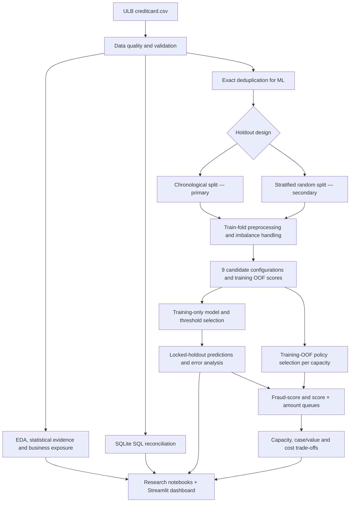

<div align="center">

#  Credit Card Fraud Analytics & Investigation Optimization

### From rare-event fraud detection to smarter, capacity-constrained review decisions

**Python · SQL · Statistical Analysis · Machine Learning · XGBoost · Streamlit · Jupyter**

[](https://www.python.org/)
[](https://pandas.pydata.org/)
[](https://scikit-learn.org/)
[](https://xgboost.readthedocs.io/)
[](https://streamlit.io/)
[](https://www.sqlite.org/)

**Portfolio case study · Historical, offline evaluation · Reproducible research workflow**

[Key Findings](#-key-findings) · [Live-Style Dashboard (Local)](#-interactive-streamlit-dashboard) · [Research Notebooks](#-four-research-notebooks) · [Getting Started](#-getting-started) · [Methodology](#-machine-learning-and-validation-methodology)

</div>

---

##  Project overview

Credit card fraud creates two related but different analytical challenges: **identifying fraudulent transactions** and **deciding which transactions deserve investigation when analyst capacity is limited**.

This end-to-end project moves from data-quality checks and SQL analysis through statistical evidence, supervised fraud modeling, **real saved holdout predictions**, and a fixed-budget comparison of two investigation-queue strategies:

- **Fraud-score ranking** — prioritize transactions with the highest model scores.
- **Value-aware ranking** — prioritize by `fraud_score × transaction_amount`.

The goal is not to declare one strategy universally superior. It is to reveal **how fraud-case recall, recorded fraudulent-value recall, legitimate-alert burden, and hypothetical economics change with review capacity**.

> [!IMPORTANT]
> This project evaluates an anonymized, historical public dataset. It is **not** a live banking platform, an automated card-blocking service, a validated fraud-loss forecast, or evidence of actual financial savings.

### Questions this project answers

1. What does fraud look like in a highly imbalanced transaction dataset?
2. Which apparent risk patterns have statistical support—and are they operationally meaningful?
3. Can models detect fraud in a **locked chronological holdout** without holdout-based model or threshold selection?
4. Do high case recall and high recorded-value recall imply the same outcome?
5. Which investigation ranking works better at **5, 10, 20, or 50 reviews per 10,000 transactions**?

---

##  Key findings

| Finding | Verified observation | Why it matters |
|:--|--:|:--|
| Original transactions | **284,807** | Primary descriptive/statistical population |
| Fraud records | **492 (0.1727%)** | Extreme class imbalance |
| Exact duplicate rows | **1,081** | Deduplicated before model splitting |
| Recorded fraudulent amount | **60,127.97** | Dataset amount units, **not confirmed bank loss** |
| Lowest amount decile | **36.79% of fraud cases / 0.23% of fraudulent value** | Case count alone can misrepresent value exposure |
| Highest amount decile | **17.28% of fraud cases / 78.11% of fraudulent value** | Recorded value concentrates in different segments |
| Zero-amount versus positive-amount relative risk | **~9.00×** | Observed association, not a causal or automatic-blocking rule |
| Chronological model average precision | **0.7831** | Evaluated on unseen, time-ordered historical transactions |
| Chronological fraud-case recall | **72.90% (78 of 107)** | Evaluated at the **training-selected** score threshold |
| Chronological fraud-value recall | **71.22%** | Recorded fraud amount flagged by classifier |

###  Flagship insight — investigation capacity changes the winner

The same chronological holdout contains **85,118 transactions**. Compare predefined queues using equal review capacity:

| Reviews / 10k | Review slots | Fraud-score value recall | Score × amount value recall | Value-aware minus score-only |
|---:|---:|---:|---:|---:|
| 5 | 42 | 19.28% | **62.98%** | **+43.70 pp** |
| 10 | 85 | 70.94% | **71.43%** | +0.49 pp |
| 20 | 170 | **87.75%** | 83.84% | −3.91 pp |
| 50 | 425 | **87.96%** | 87.13% | −0.83 pp |

At **5 reviews/10k**, the value-aware heuristic covers far more recorded fraudulent value. At **20 reviews/10k**, fraud-score ranking also catches many more fraud cases (**84 versus 28**) and produces fewer legitimate alerts (**86 versus 142**).

**Interpretation:** There is no universally best ranking across budgets. Both policies are reported on the holdout for transparency; the policy used as the *training-selected strategy* is chosen using **training out-of-fold (OOF) evidence**, not by picking the holdout winner.

---

##  Explore the project

| Start here | What you will find |
|:--|:--|
| **[Notebook 01 — Data Understanding & EDA](notebooks/01_data_understanding_eda.ipynb)** | Source data, quality, prevalence, amounts, elapsed time and PCA patterns |
| **[Notebook 02 — Statistical & Business Insights](notebooks/02_statistical_business_insights.ipynb)** | Nine exploratory tests, effect sizes, uncertainty, segment exposure, review rules and illustrative economics |
| **[Notebook 03 — ML Experiments & Evaluation](notebooks/03_ml_experiments_evaluation.ipynb)** | Nine candidates per full run, leakage prevention, training-only selection, **real predictions**, diagnostics and error analysis |
| **[Notebook 04 — Investigation Optimization](notebooks/04_investigation_optimization.ipynb)** | **Eight reconstructed chronological queues**, capacity frontiers, policy selection, operational trade-offs and sensitivity |
| **[Streamlit Dashboard](dashboard/app.py)** | Five interactive, read-only analytical workspaces |
| **[SQL Queries](sql/)** | SQLite-based independent reconciliations and analytical queries |
| **[Automated Tests](tests/)** | Unit and consistency checks for analytical modules |

**Suggested reading order:** notebooks **01 → 02 → 03 → 04**. Start with Notebook 04 if your main interest is business decision-making; read Notebook 03 for model-validation details.

---

##  End-to-end architecture



### Analysis populations — don't mix the denominators

| Population | Rows | Fraud labels | Used for |
|:--|--:|--:|:--|
| Original dataset | 284,807 | 492 | EDA, statistics, business analysis, independent SQL reconciliation |
| Exact-deduplicated dataset | 283,726 | 473 | Model development and evaluation |
| Chronological training partition | 198,607 | — | Candidate CV, training OOF selection and model fitting |
| Chronological locked holdout | 85,118 | 107 | Primary model and investigation evaluation |
| Stratified random locked holdout | 85,118 | 142 | Secondary evaluation sensitivity |

One chronological boundary row is excluded from the split to preserve strict timestamp separation. The two holdouts are **different populations**, so performance differences do **not** isolate the effect of time or model choice causally.

---

##  Machine learning and validation methodology

### Model candidates

Each full experiment evaluates **nine configurations**: three model families × three imbalance strategies.

| Model family | Baseline | SMOTE | Class weighting |
|:--|:---:|:---:|:---:|
| Logistic Regression | ✓ | ✓ | ✓ |
| Random Forest | ✓ | ✓ | ✓ |
| XGBoost | ✓ | ✓ | ✓ |

The primary validation uses **three-fold, expanding-window `TimeSeriesSplit`**. Preprocessing and sampling are fitted **inside the relevant training folds**; the locked holdout is not used to select the winning model or decision threshold.

**Two distinct training-only selection stages:**

1. **Model choice:** highest pooled training-OOF **average precision (AP)**.
2. **Classification threshold:** maximize training-OOF **F1** for the chosen model.

The threshold-based classifier in Notebook 03 is not equivalent to the fixed-capacity review queues in Notebook 04.

### Chronological holdout — primary model

| Measure | Result |
|:--|--:|
| Selected model | **XGBoost + SMOTE** |
| Training-selected threshold | **0.715498** |
| Holdout observations | **85,118** |
| Fraud labels | **107** |
| Average precision (AP; reported as PR-AUC) | **0.7831** |
| Precision | **82.98%** |
| Fraud-case recall | **72.90%** |
| F1 score | **0.7761** |
| Recorded fraudulent-value recall | **71.22%** |
| True positives / false positives | **78 / 16** |
| False negatives / true negatives | **29 / 84,995** |
| Recorded fraud amount flagged / missed | **10,372.83 / 4,192.16** |

**Random holdout — secondary context:** XGBoost + class weighting; AP **0.8112**, precision **93.86%**, case recall **75.35%**, F1 **0.8359**. The comparison is descriptive because both the selected model and holdout composition differ.

**Prediction audit:** Notebook 03 loads the actual `holdout_predictions.csv` rows, applies the saved training-selected threshold, reproduces the confusion matrix and metrics, and inspects false positives and false negatives. It does **not** silently retrain the model or claim that saved scores constitute a live prediction API.

---

##  Investigation optimization — from scores to decisions

The investigation analysis is a **fixed-budget, retrospective batch ranking study**, not a real-time blocking system.

**Predefined ranking functions**

```text
Fraud-score policy:  rank_i = fraud_score_i
Value-aware policy:  rank_i = fraud_score_i × Amount_i

Allowed review slots = floor(N_holdout × reviews_per_10,000 / 10,000)
```

Ties are resolved deterministically using the original row identifier. Queues are built at **5, 10, 20 and 50 reviews/10k**.

What is independently checked:

- **All eight chronological queues:** two policies × four budgets, reconstructed from real saved transaction-level scores.
- **Both objectives:** detected-fraud cases and recorded fraudulent transaction-value coverage.
- **Legitimate burden:** false alerts and recorded legitimate transaction value flagged.
- **Training-only policy choices:** preserved and reported separately from retrospective holdout comparisons.
- **Marginal capacity:** additional cases and value captured for extra review slots.
- **Economics:** clearly labeled assumptions for analyst review cost, intervention effectiveness and potential legitimate-alert friction.

> [!CAUTION]
> `fraud_score × Amount` is an **uncalibrated ranking heuristic**, not estimated expected financial loss. Even if a transaction was flagged retrospectively, that does **not** prove that an intervention would prevent a loss. All economic net values are **hypothetical**.

---

##  Interactive Streamlit dashboard

The [Streamlit app](dashboard/app.py) reads the saved analytical artifacts and does **not** retrain models. It provides five workspaces:

| Workspace | Main questions |
|:--|:--|
| **Overview** | How rare is fraud? Where are cases and recorded value concentrated? |
| **Risk & Statistics** | Which segment differences are associated with fraud, and how large are the effects? |
| **Model Lab** | What did training choose? How well did the locked holdout perform? |
| **Investigation Studio** | Which policy covers cases/value at a particular review budget? What are the false-alert and what-if economics trade-offs? |
| **Data & Methodology** | Which population and artifact produced each result? What are the boundaries? |

**Launch from the repository root:**

```powershell
.\.venv\Scripts\python.exe -m streamlit run dashboard/app.py
```

Open **http://localhost:8501** after the server starts. The app requires the matching saved `reports/` outputs to be present locally.

**Dashboard screenshots:** Once you have finalized and committed screenshots, add a gallery here using relative links such as `docs/screenshots/overview.png`, `docs/screenshots/model_lab.png`, and `docs/screenshots/investigation_studio.png`. No screenshots are linked until those repository files actually exist.

---

##  Tech stack

| Layer | Technologies |
|:--|:--|
| Data engineering | Python, pandas, NumPy, CSV validation |
| Statistics | SciPy, effect sizes, Holm correction, Wilson intervals, bootstrap uncertainty |
| Visualization | Matplotlib, Plotly |
| Machine learning | scikit-learn, imbalanced-learn / SMOTE, XGBoost, joblib |
| SQL | SQLite, analytical SQL and reconciliation checks |
| Application | Streamlit |
| Research and testing | Jupyter, VS Code, `unittest` |

---

##  Repository structure

```text
Credit_Card_Fraud_Analytics/
├── README.md
├── requirements.txt                 # verify/provide before publishing
├── requirements_dashboard.txt       # optional dashboard-specific dependencies
├── .streamlit/
│   └── config.toml                  # if used by your selected dashboard version
├── data/
│   ├── raw/creditcard.csv            # download separately; do not commit
│   └── processed/                    # generated data / SQLite
├── src/
│   ├── data_cleaner.py
│   ├── analysis.py
│   ├── visualization.py
│   ├── statistical_analysis.py
│   ├── business_analysis.py
│   ├── ml_models.py
│   ├── model_evaluation.py
│   ├── investigation_optimization.py
│   └── sql_pipeline.py
├── sql/
│   ├── schema.sql
│   ├── fraud_analysis.sql
│   └── business_queries.sql
├── dashboard/
│   ├── app.py
│   └── data_access.py
├── notebooks/
│   ├── 01_data_understanding_eda.ipynb
│   ├── 02_statistical_business_insights.ipynb
│   ├── 03_ml_experiments_evaluation.ipynb
│   └── 04_investigation_optimization.ipynb
├── tests/
├── reports/
│   ├── tables/                       # generated CSV / JSON evidence
│   └── figures/                      # generated diagnostic charts
├── models/                            # generated fitted artifacts; typically exclude
└── docs/screenshots/                  # optional, approved dashboard screenshots
```

Some generated folders and auxiliary configuration files may differ from this illustrative tree. **Do not publish a requirements or screenshot link until the target file exists.**

---

##  Getting started

### Prerequisites

- **Windows + PowerShell** for the commands below (equivalent commands can be adapted for Linux/macOS).
- **Python 3.10**, an isolated virtual environment, and Git for repository cloning.
- A local copy of the **ULB / Kaggle Credit Card Fraud Detection** CSV.
- Enough time and compute for a nine-candidate CV run if regenerating all ML artifacts. **Notebooks and dashboard do not retrain.**

### Step 1 — Clone, create the environment, install requirements

```powershell
git clone https://github.com/anandhusuresh04/REPLACE_WITH_REPO_NAME.git
cd REPLACE_WITH_REPO_NAME

py -3.10 -m venv .venv
.\.venv\Scripts\python.exe -m pip install --upgrade pip
.\.venv\Scripts\python.exe -m pip install -r requirements.txt
```

Replace `REPLACE_WITH_REPO_NAME` with the actual repository name when you create it on GitHub. The `requirements.txt` install command assumes a verified, complete dependency file has been added to the repository.

### Step 2 — Download the source data

Get the dataset from **[Kaggle — Credit Card Fraud Detection](https://www.kaggle.com/datasets/mlg-ulb/creditcardfraud)** and place:

```text
data/raw/creditcard.csv
```

There is **no real customer data or credential required**. `Time` is elapsed time; `Amount` has no verified currency.

### Step 3 — Generate descriptive, statistical, business, and SQL evidence

Run from the **repository root**, in order:

```powershell
.\.venv\Scripts\python.exe -m src.data_cleaner
.\.venv\Scripts\python.exe -m src.data_cleaner --duplicates drop --output data/processed/deduped.csv --report-dir reports/tables/data_quality/deduped
.\.venv\Scripts\python.exe -m src.analysis
.\.venv\Scripts\python.exe -m src.visualization --format png
.\.venv\Scripts\python.exe -m src.statistical_analysis
.\.venv\Scripts\python.exe -m src.business_analysis
.\.venv\Scripts\python.exe -m src.sql_pipeline
```

These reports use the **original transaction population** unless a report explicitly describes a deduplication sensitivity check.

### Step 4 — Generate complete ML experiments (compute-intensive)

```powershell
# Chronological experiment — primary evaluation
.\.venv\Scripts\python.exe -m src.ml_models --split chronological

# Random experiment — secondary evaluation
.\.venv\Scripts\python.exe -m src.ml_models --split random
```

Find the generated directories under `reports/tables/ml/` and use **each run's actual directory name** when producing associated plots and investigation outputs:

```powershell
# Example of a previously verified run ID; replace after regenerating
$run = "reports/tables/ml/chronological_dedup_withTime_463fcded"
.\.venv\Scripts\python.exe -m src.model_evaluation --run-dir $run --format png svg
.\.venv\Scripts\python.exe -m src.investigation_optimization --run-dir $run
```

Repeat the last two commands for the random run if you need full secondary dashboard/notebook coverage. **Never mix prediction files, metrics, and investigation results from different run IDs.**

### Step 5 — Explore the notebooks and dashboard

To work in Jupyter/VS Code:

```powershell
.\.venv\Scripts\python.exe -m pip install ipykernel
.\.venv\Scripts\python.exe -m ipykernel install --user --name fraud-analytics --display-name "Python (Fraud Analytics)"
```

Open the notebooks in order and use **Restart Kernel and Run All**, selecting `.venv` rather than Anaconda `base`.

```powershell
# Launch the analytical dashboard
.\.venv\Scripts\python.exe -m streamlit run dashboard/app.py
```

### Step 6 — Run automated tests

```powershell
.\.venv\Scripts\python.exe -m unittest discover -s tests -v
```

**Reproducibility status:** Analytical tests and notebooks passed during development, but a clean machine/clean clone installation and full regeneration check has **not yet been verified**. Do not interpret the documentation as a claim that a one-command production deployment is available.

---

##  What was validated?

| Component | Development evidence |
|:--|:--|
| Data quality | 284,807 original records; 1,081 exact duplicates; missing-value and schema checks |
| Business and statistics | Fraud counts and recorded amount reconciled across saved reports |
| ML | Nine candidate configurations per full experiment; training-only selection; saved holdout predictions independently audited |
| Chronological prediction audit | 85,118 rows; **TP 78 / FP 16 / FN 29 / TN 84,995** |
| Investigation | **8/8** chronological queues reconstructed from real predictions and reconciled |
| SQL | Independent SQLite reconciliation with Python source totals |
| Notebooks | All four final research notebooks executed locally with project `.venv` |
| Dashboard | Five workspaces validated during development; final screenshots/theme require local review |

The notebook tests check the specific invariants they implement; they are **not** evidence of production safety or future predictive performance.

---

##  Limitations and responsible interpretation

- **Short observation period:** Roughly two days of historical transactions; no support for claims about long-run drift or recurring local-time seasonality.
- **Anonymized variables:** `V1`–`V28` have no verified business semantics; the project does not infer customer identities or transaction purposes.
- **Different denominators:** Descriptive analyses retain original duplicates; ML uses an exact-deduplicated population.
- **Exploratory significance:** Multiple-testing correction reduces false discovery risk but does not make associations causal or operationally actionable.
- **Model scores:** Discrimination and ranking performance do **not** establish calibrated probabilities or production-ready thresholds.
- **Historical value ≠ loss:** `Amount` is not a verified chargeback, recovered amount, or bank loss.
- **Financial what-if ≠ realized saving:** Cost, prevention effectiveness, and legitimate-transaction friction are assumed inputs.
- **Retrospective evaluation ≠ deployment:** No live fraud decisions, automatic holds, intervention validation or future-distribution guarantees.
- **Selection integrity:** Model, classification threshold and investigation policy are chosen from training evidence, **not from hindsight on the locked holdout**.

### Dataset provenance

**ULB Machine Learning Group / Worldline credit card transactions**, distributed as **[Credit Card Fraud Detection on Kaggle](https://www.kaggle.com/datasets/mlg-ulb/creditcardfraud)**. Check the source's license and access terms before redistribution. Keep the raw 150 MB `creditcard.csv` out of Git history unless redistribution is explicitly permitted and intentional.

---

##  GitHub publication checklist

- [ ] Verify `requirements.txt` exists, installs cleanly and matches the final `src/` and notebook imports.
- [ ] Add `.gitignore` exclusions for `.venv/`, raw data, generated SQLite, model binaries, caches, secrets and temporary reports not intended for Git.
- [ ] Decide which **small, reproducible report artifacts** will be included so notebooks and dashboard have a clear first-run path.
- [ ] Confirm the `.streamlit/config.toml` theme file if the chosen app version requires it.
- [ ] Save the four executed notebooks and remove obsolete notebook versions and bulky unnecessary outputs.
- [ ] Add and verify local dashboard screenshots before linking them in this README.
- [ ] Run the tests and perform a clean-clone reproducibility check when practical.
- [ ] Check model experiment identifiers and metrics before final publication.

---

<div align="center">

###  Connect with Me

Let's connect! Feel free to reach out for collaborations, data discussions, or opportunities.

<a href="https://www.linkedin.com/in/anandhu-suresh-in/" target="_blank" rel="noopener noreferrer">
  
</a>
&nbsp;
<a href="mailto:anandhu.suresh.dev@gmail.com">
  
</a>
&nbsp;
<a href="https://github.com/anandhusuresh04" target="_blank" rel="noopener noreferrer">
  
</a>

<br />
<br />

**Built with Python, SQL, statistical reasoning and an emphasis on auditable decision-making.**

</div>
